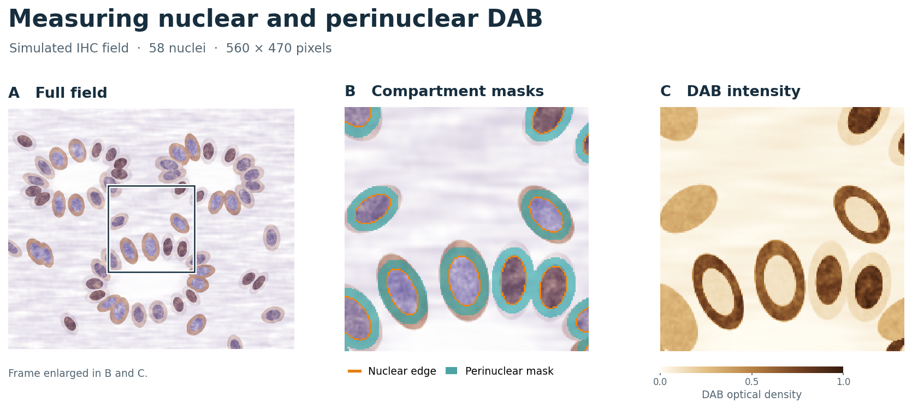
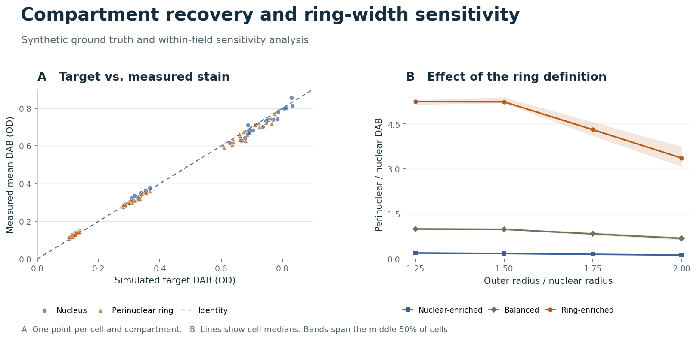

# Where is the brown stain?

**Nuclear and perinuclear DAB quantification in synthetic immunohistochemistry images**  
Zhekai Liu · Biomedical Informatics

A cell can have strong brown staining around a pale nucleus. A small shift in the segmented nuclear boundary can move that signal from one compartment to the other. This project makes that error visible and measurable. Start with the same stained field, compare three versions of the nuclear masks, and check the measurements against the signals used to generate each cell.



**Explore a cell.** Download [the offline explorer](examples/explorer.html) using GitHub’s **Download raw file** button, then open the HTML file in a browser. Select a cell and switch between the stained image, mask overlay and DAB map. The concentration targets stay fixed when you change the measurement boundary. The explorer runs locally with no installation.

**Inspect the analysis.** The [worked notebook](notebooks/compartment_measurement.ipynb) shows the measurement, quality flags and boundary experiment with saved outputs. The [measurement module](ihc_demo/measurement.py) contains the implementation. The [per-cell table](examples/cells.csv) contains the numbers behind the images.

## What changes when the boundary moves?

The default field contains 58 synthetic nuclei. The generator places high DAB signal in the nucleus, in a surrounding elliptical band, or in both. The estimator receives only an RGB image and integer nucleus labels. Moving the mask edge by two pixels changes the region sampled around each nucleus. The RGB pixels and target values stay fixed across conditions.

| Supplied nuclear mask | Cells with a ring measurement | Ring mean absolute error (OD units) | Ring Spearman ρ vs. target |
|---|---:|---:|---:|
| Reference | 58 / 58 | 0.011 | 0.992 |
| Eroded by 2 px | 58 / 58 | 0.140 | 0.698 |
| Dilated by 2 px | 58 / 58 | 0.063 | 0.974 |

Erosion moves the start of the sampling ring into pixels that originally belonged to the nucleus. In this field that mixes opposite staining patterns. Dilation shifts the ring outward, where surrounding tissue can dilute the signal. With the dilated mask the rank correlation is still 0.974, even though the mean absolute error is almost six times the reference value. Reporting both exposes a problem that rank correlation alone can hide. [Full results for five seeds](examples/mask_stress.csv)

A second experiment keeps the nuclear masks fixed and changes only the ring width. In the default field, the median ring-to-nucleus ratio for ring-enriched cells falls from 5.24 at an outer scale of 1.50 to 3.37 at 2.00. The [sensitivity table](examples/sensitivity.csv) contains one row per cell and scale.



## Reproduce the project

Run these commands in the repository root with Python 3.11 or later. The example runs on a CPU. The environment commands below use a macOS or Linux shell.

```bash
python3 -m venv .venv
source .venv/bin/activate
python -m pip install -e .
python -m ihc_demo demo --seed 17 --out runs/demo
python -m ihc_demo benchmark --out runs/benchmark
python -m unittest discover -s tests -v
```

Open `runs/demo/explorer.html`. The demo also exports labeled nuclear and ring TIFFs, a floating-point DAB image, a per-cell CSV, assigned targets and two figures. The benchmark repeats the three mask conditions for seeds 17, 31, 47, 59 and 73. To edit and run the walkthrough, install `python -m pip install -e '.[notebook]'` and run `jupyter lab notebooks/compartment_measurement.ipynb`.

To run just the quantitative stage against the included example inputs:

```bash
python -m ihc_demo measure --rgb examples/field.png --labels examples/nuclei.tif --outer-scale 1.5 --out runs/measure
```

The measurement command expects a field-sized 8-bit RGB image and a spatially aligned, single-channel integer label image. Each positive integer identifies one nucleus and zero marks background. An optional `--tissue-mask` accepts a single-channel image whose nonzero pixels are eligible for ring sampling. Pixel spacing is assumed to be isotropic. [Geometry, stain model and quality flags](METHODS.md)

## Research context and scope

This portfolio draws on Zhekai Liu’s work on LINE-1 ORF1p staining in endometrial carcinoma in David Fenyö’s lab at NYU. In that research, pretrained Mesmer supplied nuclear segmentations. Zhekai’s work included building the image-analysis workflow, defining nuclear and perinuclear measurements, and comparing their summaries with pathologists’ slide-level assessments. [Mesmer publication](https://doi.org/10.1038/s41587-021-01094-0)

The example software, interactive viewer and synthetic images were prepared for this portfolio with AI coding assistance. The simulation supplies the instance masks. All numerical results in this repository describe generated images. The original research used a different stain-deconvolution implementation and also examined nuclear cores. Real-tissue performance, ORF1p specificity and segmentation accuracy would each require separate evidence.
